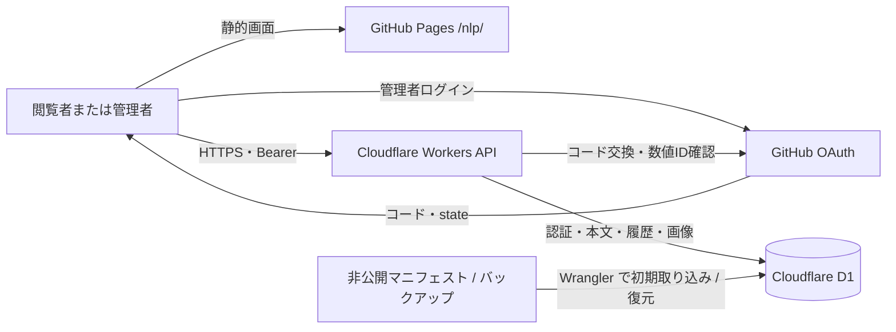

# アーキテクチャ

サイトの直接リンクは `/nlp/#s-2-5-1/eq-2.12` の形式です。先頭が章節 ID、スラッシュの後が任意の節内アンカーです。Pages には一枚の HTML を出力し、認証後にルートを解決します。新しい章節は D1 の目次取得に反映されます。

## D1 のデータ

- `book` と `sections` が書籍メタデータ、章節、演習、記号表、参考文献とその構造を保持します。印刷ページと PDF 上のページは個別の列です。
- `visible_sections` は公開中で有効な祖先を持つ章節だけを返します。直接取得・検索・図版の認可にも使います。親の公開状態の変更は配下に反映されます。
- `revisions` は初版と各更新時の全章節スナップショットを保持します。更新条件は既存の `revision` と一致することです。トリガーが版と検索索引を同じ書き込みに記録します。削除・復元も新しい版になります。
- `assets` と `asset_chunks` が図版のメタデータと32 KiB単位のBLOBを保持します。ブラウザは WebP への圧縮を試み、API は WebP・PNG・JPEG の識別子と1,500,000バイトの上限を検証します。交換時は別IDを付けて参照を更新します。古い図版は履歴から参照でき、削除済み図版は管理画面から復元できます。
- `search_index` は FTS5 trigram を使う全文索引です。3文字以上は部分一致、1〜2文字は `instr` で検索します。結果は25件ずつ返します。書籍全体の収録後は、短い語の検索で D1 の読み取り数を観測してください。
- `viewer_settings`、`sessions`、`auth_limits`、`oauth_states` は認証データです。本文や画像と独立して管理します。

## API

すべて `/v1` 配下です。認証の開始と認可コード交換には JSON を使います。認証済みの操作は `Authorization: Bearer …` を要求します。

| メソッド | パス | 権限と用途 |
| --- | --- | --- |
| POST | `/auth/login` | 共通パスワードで閲覧セッションを取得 |
| POST | `/auth/github/start`、`/auth/github/exchange` | PKCE と state を用いた管理者ログイン |
| GET / POST | `/auth/session` / `/auth/logout` | セッション確認・破棄 |
| GET | `/toc`、`/sections/:id`、`/symbols` | 目次・本文・記号表 |
| GET | `/search?q=…&after=…` | キーワード検索 |
| GET | `/assets/:id` | 認証付き画像。画面では Blob URL を使う |
| POST | `/admin/sections` | 章節の追加 |
| PUT / DELETE | `/admin/sections/:id` | 版番号を確認して更新・論理削除 |
| GET / POST | `/admin/sections/:id/history` / `/admin/sections/:id/restore` | 版・差分の取得と復元 |
| POST | `/admin/assets?id=…&section=…` | バイナリと `X-Asset-Metadata` を登録 |
| DELETE / POST | `/admin/assets/:id` / `/admin/assets/:id/restore` | 図版の論理削除・復元 |
| POST | `/admin/password` | パスワード更新と既存閲覧認証の失効 |
| GET | `/admin/export` | バックアップ開始・終了時の整合性確認 |

管理画面のバックアップは章節、全リビジョン、バイナリを認証付き API で取得し、ブラウザで JSON を組み立てます。エクスポート開始時と終了時にコンテンツ版を確認します。認証データは対象外です。
